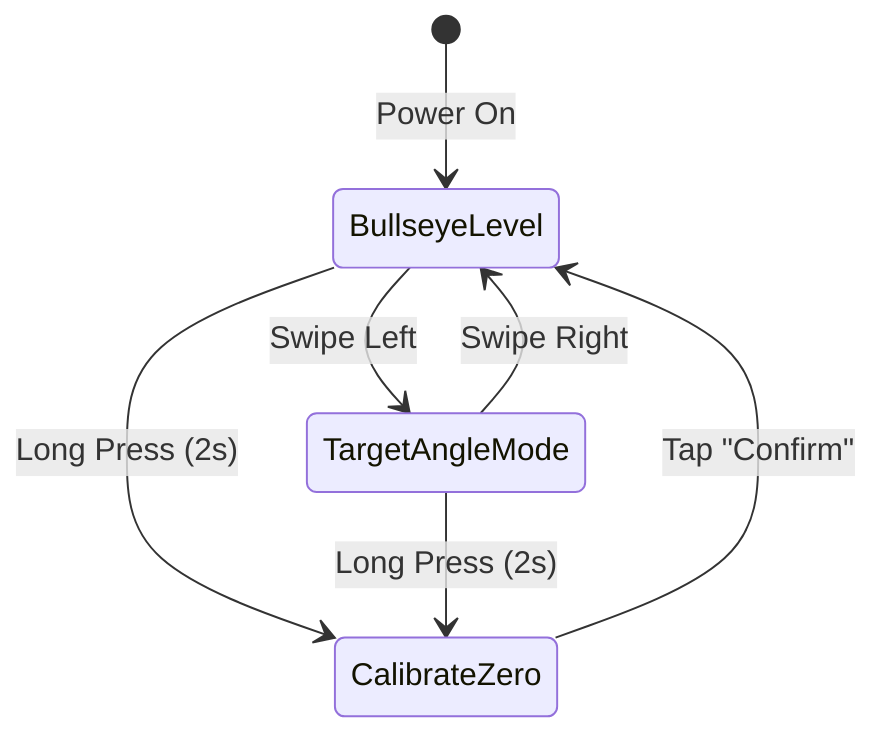

# Bullseye Engineering Notes

## 1. Hardware Architecture

### Waveshare ESP32-S3-Touch-LCD-1.28 Pinout
```text
┌────────────────────────────────────────────────────────┐
│             Waveshare ESP32-S3-Touch-LCD-1.28          │
├───────────────────┬──────────────┬─────────────────────┤
│ Peripheral        │ Driver Chip  │ ESP32-S3 Pin        │
├───────────────────┼──────────────┼─────────────────────┤
│ LCD MOSI          │ GC9A01A      │ GPIO 11             │
│ LCD SCLK          │ GC9A01A      │ GPIO 10             │
│ LCD CS            │ GC9A01A      │ GPIO 9              │
│ LCD DC            │ GC9A01A      │ GPIO 8              │
│ LCD RST           │ GC9A01A      │ GPIO 14             │
│ LCD Backlight     │ PWM          │ GPIO 2              │
├───────────────────┼──────────────┼─────────────────────┤
│ I2C SDA           │ Shared Bus   │ GPIO 6              │
│ I2C SCL           │ Shared Bus   │ GPIO 7              │
│ Touch INT         │ CST816S      │ GPIO 5              │
│ Touch RST         │ CST816S      │ GPIO 13             │
│ IMU INT1          │ QMI8658      │ GPIO 46             │
│ IMU INT2          │ QMI8658      │ GPIO 45             │
├───────────────────┼──────────────┼─────────────────────┤
│ Battery Voltage   │ ADC Divider  │ GPIO 1 (2:1 Ratio)  │
│ Boot Button       │ Switch       │ GPIO 0              │
└───────────────────┴──────────────┴─────────────────────┘
```

---

## 2. Sensor Fusion & Angle Math

### Coordinate Frame
* $+Z$ axis: Perpendicular out of the screen (facing user).
* $+X$ axis: Horizontal right.
* $+Y$ axis: Vertical top.

### Accelerometer Tilt Equations
Gravity acceleration vector $\vec{a} = (a_x, a_y, a_z)$:
$$\text{Pitch } (\theta) = \arctan2\left(a_y, \sqrt{a_x^2 + a_z^2}\right) \times \frac{180}{\pi}$$
$$\text{Roll } (\phi) = \arctan2\left(-a_x, a_z\right) \times \frac{180}{\pi}$$

### Vibration Immunity Strategy
Power drills create heavy motor vibration (high frequency noise $50\text{ Hz} - 500\text{ Hz}$):
1. **Hardware ODR / LPF:** Configure QMI8658 internal digital low-pass filter (DLPF) to ~20 Hz cutoff.
2. **Complementary Filter:**
   $$\text{Angle}_{t} = \alpha \cdot (\text{Angle}_{t-1} + \omega \cdot \Delta t) + (1 - \alpha) \cdot \text{Angle}_{\text{accel}}$$
   where $\alpha \approx 0.96$ to $0.98$.
3. **Motion Gate:** When $|\vec{a}| - 1.0\text{g} > \text{threshold}$ (violent shaking/hammering), freeze accelerometer weight and rely 100% on gyroscope integration.

---

## 3. UI Modes (LVGL Design)



### Screen 1: Bullseye Level (Gravity Mode)
* Concentric rings representing $1^\circ, 2^\circ, 5^\circ$ error bands.
* Animated bubble or crosshair centered on screen.
* Outer circle turns vibrant **Green** when within $\pm 0.5^\circ$, **Yellow** when $\pm 2.0^\circ$, **Red** when off.
* Large bold digital readout in center (e.g. `90.0°`).

### Screen 2: Target Bevel Mode
* Set specific target angle (e.g., $45^\circ$ for framing or chamfers).
* Arc gauge indicating offset from target.

---

## 4. Mechanical Mounting Ideas (Target: CRAFTSMAN V20 CMCD702)

Your drill is the **Craftsman V20 1/2-in Cordless Drill (CMCD702 / Kit 5018700285)**. It features a clamshell glass-filled nylon housing with rear radial motor cooling vents and a V20 slide-on battery base.

```text
               [Keyless Chuck]
                    │
            ┌───────┴───────┐
            │  Gear Box     │   [Top Speed Switch]
            └───────┬───────┘          │
                    │         ┌────────┴────────┐
         [Chuck Centerline] ──┼─ Motor Body     │ ◄── [POSITION 1: Back Cap Cup]
                              └────────┬────────┘     (Direct line of sight with bit)
                                       │
                                   [Handle]
                                       │
                              ┌────────┴────────┐
                              │  V20 Battery    │ ◄── [POSITION 2: Battery Slide Mount]
                              └─────────────────┘
```

### Best Mounting Positions:

1. **Rear Motor Cap "Cup" (Recommended — True xDrill Style):**
   * **Placement:** Directly on the back hemisphere of the motor housing.
   * **Why it's best:** Sits directly in-line with the chuck axis. When looking forward while drilling into a wall or stud, your eyes look straight down the center line of the hole.
   * **Attachment:** A 3D-printed slip-on cap with compliant snap tabs that grip the rear seam/recessed vent slots, or an elastic hook-and-loop wrap strap around the top body.

2. **Top Spine Saddle Mount:**
   * **Placement:** Clipped across the top ridge behind the 2-speed slider switch.
   * **Why it's good:** Best visibility when drilling downwards into floor joists, workbenches, or pocket holes.

3. **Belt Clip Screw Anchor:**
   * Craftsman V20 drills have a threaded brass insert near the battery foot intended for a belt hook. We can design a stiff bracket extending upwards from this screw hole.

